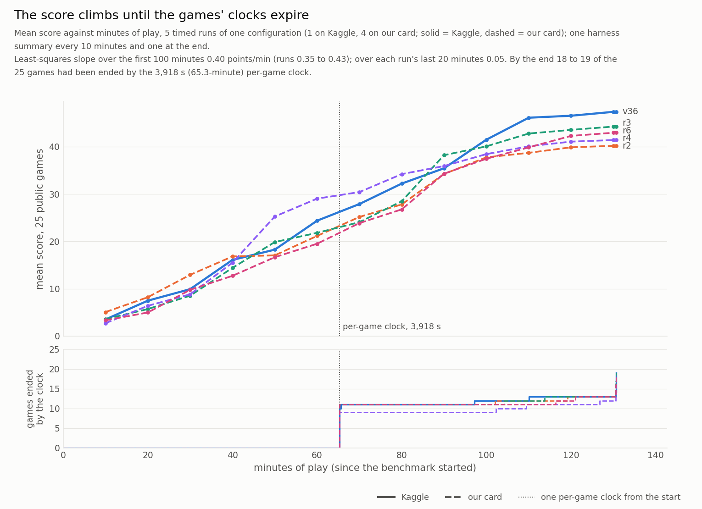
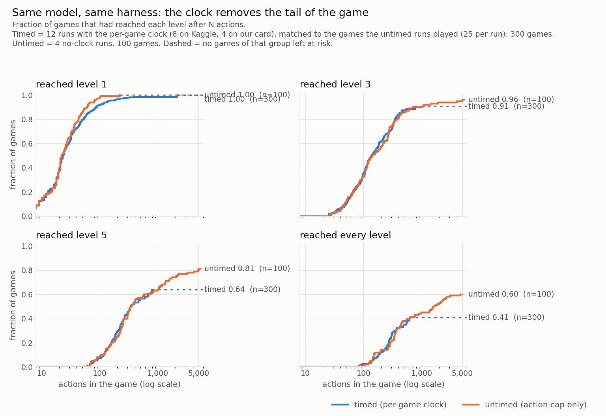
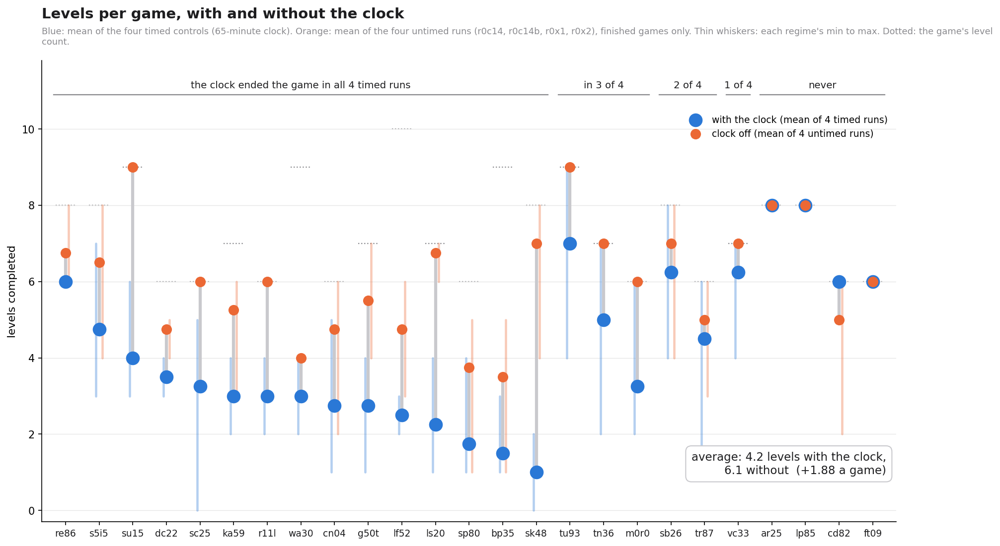

# From Synesthesia to Lobotomy: What a Benchmark on a Clock Can and Cannot See

*Long-form paper, revised 2026-11-09. Every number carries its source in brackets; the source key is at the end. The native-tower untimed runs are in (section 4); the final selection is 57886730 and 57790633.*

## Summary

We ran the same model on the same harness over the 25 public ARC-AGI-3 games, fourteen games sharing the card, with
the per-game clock and without it. Without it the model cleared 13 to 16 of 25 games in full against the timed
controls' 6.5 and gained 1.88 levels a game, run-level 95% CI [+1.17, +2.63], four runs against four
(section 4; intervals at these run counts are approximate) [source: results_notes/untimed_c14_vs_controls_n4_2026-11-08.json:77-94; results_notes/experience_efficiency_c14_2026-11-08.txt:13-21].
Under the clock, serving capacity registers as capability. The one agent-side ablation the instrument resolved was a
loss: removing the model's echoed prior-turn reasoning cost 29.60 points, run-level [−39.55, −20.04] (section 3)
[RL:9]. The perception arms we built the project to test resolved in neither direction (tower off −3.62,
[−14.01, +6.76]; native tower +2.07, [−8.80, +12.88]) [RL:10-11], on an instrument where identical code scored 54.70
and 32.22 a day apart [EC:61]. From the other end of the leaderboard, the presumptive public winner reached the same
place: "the gains from those experiments didn’t match what I got from the extra tokens that infra improvements made
possible" [FQ; FA:755466, comment 3550435].

## 1. The question we started with

Every entrant we have read feeds the model the board as text: a grid of digits or glyphs for the model to read, sometimes
with a rendered picture beside it for the model to read as well. That is not how a board reaches a person. Nobody
computes seven hundred nanometers and concludes "red." Something before the mind has already done that, and the mind
receives the color, not the measurement. Perception is upstream of reasoning, and most of what makes a 64-by-64 grid
of colored cells easy for a child and hard for a language model happens in that upstream stage.

So the design question was never "which text encoding reads best." It was whether the board could arrive as a percept
at all. Synesthesia was the attempt. Our model, Qwen3.8-Flash-Next, has its own vision tower, a 449-million-parameter
encoder that turns pixels into the embedding rows the language model reads. We distilled an 18.2-million-parameter
student from it on ARC boards (notes: plan S2c, 2026-10-03, commit 844f775), so that each 64-by-64 board becomes 1,024
image-embedding rows without rendering a picture and without loading the tower; the server accepts them as
`image_embeds`. A cell's color then reaches the model the way a grapheme-color synesthete sees a letter: already
colored, before any reasoning about it. The analogy is the motivation for the design, not evidence that the model
perceives as a person does; nothing in this paper tests that. The quant is ours (NVFP4 experts, FP8 attention, an NVFP4 multi-token head,
calibrated on 976 of our own windows [source: results_notes/paper_draft_v4_2026-10-27.md §2]), the runtime is ours (vLLM
0.31 rebuilt for Python 3.13 with bounded KV copies and parallel shard prefetch), and the harness is ours, in the Tufa to Han Solo to us lineage credited in sections 5 and 8, with our changes behind switches,
one per run, each with a test.

We built it, and ran a few tests, and then the instrument we had built it for told us something else was moving the
score. The rest of this paper is about what the instrument could see, what it could not, and what it did to us.

---

## 2. What the instrument can see

### 2.1 The same notebook, twice

The candidate_pinned notebook (harness 848f336 plus the boot clock) was run on Kaggle as a commit run and scored 54.70
on the public 25 games; the investigator re-ran the identical notebook in the editor on 11-02 and it scored 32.22 [EC:61]. Same
code, same model, same token budget; the 32.22 re-run against the 54.70 commit run: 6.67M against 6.70M generated
tokens, 848 against 834 tokens per second, 2 h 11 m of play against 2 h 14 m [EC:61]. What differed was play:
9,203 actions against 12,741, 6 wins against 10, 8 pool-clock stops against 4, 22 analyzer timeouts against 16 [EC:61]. Paired game by game with analysis/compare_arm_groups.py as it
then stood (games resampled, runs not), the two runs gave Δ = −22.47, 95% CI [−35.68, −10.91], sign 4/18/3,
game-level sign-test p = 0.004: the script called two runs of identical code a resolved loss [EC:62; PRL:6-8]. A
valid procedure can also produce a false positive; section 2.4 gives the argument, which is about the run-level
variance the pair exposes, not about the one call.

Where the 22 points went is the useful part. Six games lost more than 50 points each: tn36 100 → 3.6 (levels 7 → 1),
r11l 100 → 14.3 (6 → 2), tr87 88.2 → 7.6 (6 → 2), sb26 90.6 → 23.3 (8 → 4), ar25 96.3 → 33.1 (8 → 5), s5i5
58.3 → 8.2 (6 → 2), each with similar or fewer actions and 1.5 to 2 times the tokens per action: the agent reasoned
longer and cleared less, stuck in the first levels [EC:63]. Three games moved the other way (re86 +14.2, su15 +9.2,
wa30 +2.1) and nine stayed within ±10 [EC:63]. Per-game outcomes are close to bimodal on whether the mechanic is found
early; that, not throughput, is the run-to-run variance when tokens per second and play time are matched [EC:63].

This was not the only identical-code pair on Kaggle. Room S K1 (Room S, G-s and G-c are the game-room prompt arms, §2.7), one notebook (version id 363241028) run twice, scored 42.89
(7,155 actions) on 10-28 and 34.04 (6,838 actions) when the investigator re-ran it on 11-02 [EC:77-82; RK: Gs_room-s-k1_363241028, room_s_k1_v2]. The second run reached
its first action 265 s sooner than the first (boot to harness start 689 s against 954 s), and the faster boot did not
carry the score [EC:77-82]. Both pairs' second runs were lower; two pairs is not evidence of a direction [EC:61, 81-82]. A
third same-code pair came from the start-guard arm: v37 scored 51.37 as a commit run, and v37 with the start guard,
which cannot act on a commit run and so replays v37, scored 32.78 [EC:51; SR:13-15; RK: SR_start-retry-k2].

### 2.2 Fixed-host controls, and what the platform adds

The local control series is four runs of the anchor notebook (harness 8552964) on one RTX PRO 6000, 25 public games,
9,300 s: r2 40.19, r3 44.26, r4 41.41, r6 42.96, mean 42.21 [RL:9; VS:51]. The run-mean sd of the four is 1.78 [RL:9];
of r2–r4 alone, 2.09 [RL:10]. r5 died within seconds of starting on a full disk and never played
[results_notes/prestate_batch_a_2026-10-26.md:78]; its rerun r5b (47.09; a control only for Batch A, the arm that turned on eleven agent-side switches at once, prompt, tool-result and sandbox changes to the playing agent ported from dfranzen's Apache-2.0 solution and absent from the submitted v36 [results_notes/prestate_batch_a_2026-10-26.md:13, 21, 53]; the clock comparisons of section 4 use r2, r3, r4 and r6) ran the arms notebook at 12a000d with every switch off,
was added as a fourth control after the Batch A pre-statement and before any score, and on its own moved the Batch A
estimate by about 1.3 points [BL:9-10, 21-23]. The Kaggle control pool C1–C7 (harness 12a000d, all switches off, equal
to 8552964 by parity tests) has mean 39.06, sd 5.07, range 32.57–45.95 [VS:49-50]; inside the Batch A same-time pairs
the control alone swung from 32.57 to 45.95, 13.4 points on the same code [BK:26-27].

The server series is the fixed-host noise figure for the submitted configuration. On the GCP server (RTX PRO 6000,
g4-standard-48), each run alone on the card, candidate_pinned (CP, 848f336 + boot clock) scored {45.49, 35.78, 43.82,
47.74, 45.73, 47.94}, mean 44.42, sd 4.50, range 12.2 points at n = 6 on identical code and hardware; the alternating
agent-clock arm (AC) scored {49.70, 44.79, 35.44, 39.31, 44.98, 41.96}, mean 42.70, sd 4.97 [EC:69-70, 72]. Kaggle's two runs of
the identical candidate_pinned notebook, 54.70 and 32.22, are 22.5 points apart; with the 38.58 run of the candidate
before the pinned-memory fix, the three have sd about 11.6 at n = 3, about 2.5 times the fixed-hardware spread [EC:64,
72]. The platform is the candidate explanation for the difference between the two spreads, not one these runs
isolate: one of the three Kaggle runs is a different configuration (the pre-fix 38.58), and three and six runs are
small samples for comparing spreads [EC:64, 72].

### 2.3 Hidden-set replicates

Our hidden scores (the public leaderboard averages 55 of the 110 private games [results_notes/competition_pages_2026-11-07.md:27]) include three
identical-configuration sets. v36 (kernel version 362609521) scored 20.90 (57704437), 21.85 (57725544) and 20.44
(57835561), range 1.41 [D4:124-126]; a fourth submission of the same version, 57680782, ended in a "system
error" [VS:7-8]. candidate_pinned scored 23.21 (57886730) and 21.90 (57902610, the investigator's identical copy), gap 1.31
[D4:129-130], and a post-deadline late entry, 57925231, scored 19.37, giving n = 3 on the public half with
mean 21.49, sd 1.93 [LS:43-45]. An earlier pair, 19.15 / 19.52, has gap 0.37 [D4:116-117]. The two rooms
are single hidden runs: G-s (CL1's text, 1c4799d) 21.75 (57790633) and G-c (the investigator's text, be9603e) 15.28 (57761528)
[D4:127-128].

Our hidden replicate gaps are small for v36 (range 1.41) and the earlier pair (0.37) and wider for candidate_pinned (23.21, 21.90, 19.37: a 3.84 spread), and both are properties of our runs, not of the hidden set:
five hidden runs of one other notebook's code (Franzen's, including Tamrazov's copies) span 24.54 to 35.35 on the same
55 games [EC:23-24]. Kaggle exposes hidden totals only, not per-game results, so a hidden comparison is a comparison of run means
and sds with no paired-by-game interval [LS:28-30].

The repository's `main` branch is a publication snapshot assembled on November 8 and 9, and its commit history says nothing about when a pre-statement was written. The branch `prestatement-history` does: it is the lab repository's own history for the forty pre-statement files, 150 commits from October 26 to November 8 with their dates as recorded, filtered to those files and otherwise unchanged, with the published versions as its final commit.
### 2.4 Why game resampling called identical code a loss, and what the run-level bootstrap does

Every interval in this paper came from analysis/compare_arm_groups.py resampling games only [PRL:10-11]. Each game is its own conversation, a fresh agent with nothing carried across games
[results_notes/taaf_review_qwen_flash_2026-10-14.md:40], but the games of one run share a host, whose load time sets the per-game clock, a concurrency
pool of fourteen slots, one KV cache and, under the pool clock, one time budget; any of these can move many games
together, and none was measured as a mechanism. Games are therefore not independent draws and the interval is too
narrow; this is the classic cluster unit-of-analysis error, trials inside a cluster treated as independent [PRL:7-10].
The identical-code pair of 2.1 is the illustration, not the proof: a false positive can occur under a valid procedure
too. The argument is that the run-level variance the replicate pairs show (2.1, 2.2) is real and the game-only
interval ignores it.

The target of inference is these 25 public games under replicated runs: every comparison asks how an arm's runs
differ from the control's on this game set, and the run is the unit of replication. Resampling games as well is a
sensitivity analysis toward a population of games like these. Runs and games are crossed (every run plays every
game), and for crossed data the two-stage resampling below is a conservative approximation, not an exact one (Owen
and Eckles 2012 [OE]).

The fix, pre-stated on 11-02 before any interval was recomputed [PRL:3], adds a two-stage bootstrap under `--cluster`:
each resample draws runs with replacement within the arm and within the control (sizes preserved), computes per-game
group means, then draws games with replacement and takes the mean paired delta; 10,000 resamples, seed 0 [PRL:14-16].
With 3 runs per arm the run stage has 10 distinct multisets per group, so the cluster interval is coarse; it is still
the one that matches the unit of replication [PRL:17]. At two to four runs per arm, which is every arm in this paper
but the six-run server series, the run-level intervals are approximate. At n = 1 per group the script withholds the
verdict rather than print a number it cannot support [RL:23-24]. The pre-statement predicted that no-echo would stay
resolved, that on/off, native and Batch A would stay not resolved with wider intervals, and that AC against CP would
stay centered on zero [PRL:25-28]. All predictions held [RL:5]; the cluster intervals came out 1.15 times as wide as
the game-only ones for no-echo, 1.53 to 1.58 times for the four other arms on fixed hosts, and 1.78 times for Batch A
on Kaggle (our arithmetic on the widths in [RL:9-14]). The game-only statistic stays reported beside the cluster one, and no number is
omitted for its direction [PRL:13, 32; RL:26-27].

How much of a game's score is the draw? From the three identical ON runs (r2, r3, r4) the per-game score has
between-game variance 790.2 and within-game (run-to-run) variance 658.1, ICC 0.55: 45% of a game's score variance is
run-to-run luck in the shipped configuration under the 3,918 s clock; the OFF arm has ICC 0.68 (between 831.8, within 396.2) [NS:13-14]. The
noise is not a clear/no-clear mixture: the clear rate is 73/75 game-runs in both arms, only sc25 and sk48 flip across
the three ON runs, and the differences, between arms and between runs, are in how far a run gets before the clock, not whether it
starts [NS:8-11]. One game shows the mechanism: cn04 scored 3.9 / 71.4 / 4.8 across identical runs, because the score
weights later levels and one extra deep level moves it by tens of points while the level count moves by one [HP:13-14].
A single-run leaderboard therefore ranks agents partly by the draw [NS:15].

The two resolved claims in this paper, the reasoning-echo loss (section 3) and the clock (section 4), rest on having been pre-specified, not on their p-values: the no-echo arm's pre-statement of 10-28 names its score and levels statistic as the primary test before the arm ran; the clock test's comparator (r2, r3, r4, r6), pairing and resolution rule were fixed in the restoration pre-statement of 10-30, and its 11-07 amendment added the concurrency-14 replicates after the first of them (r0c14) had finished and before the other three had. Neither was chosen after the fact from the table. At these run counts the exact permutation floors (1/35, 1/70) would not survive a Bonferroni correction over even four exploratory comparisons. The comparisons in the section 2.5 table are exploratory and none resolved, so no correction changes a verdict.

### 2.5 Every arm, with its run-level interval

Every row but no-echo (Section 3) is not resolved. Runs are listed so that n is visible; at two to four runs per arm the run-level intervals are approximate (2.4), and every sign-test p is game-level.

| arm (runs) | n | Δ | game-only 95% CI | run-level 95% CI | levels (run-level unless marked) | run means arm / control (sd) | verdict | source |
|---|---|---|---|---|---|---|---|---|
| Tower on/off: bo1b–bo3b (MULTIMODAL_CONTEXT=none) vs r2–r4 | 3 v 3 | −3.62 | [−9.89, +3.22] | [−14.01, +6.76] | −0.24 [−0.88, +0.41] | 42.66 39.89 32.44 (5.28) / 40.19 44.26 41.41 (2.09) | NOT RESOLVED; 17 of 24 decided games lower without the channel, under the clock; exploratory | RL:10, 16; TR:20-22 |
| Native tower: na1c–na3c vs r2–r4 | 3 v 3 | +2.07 | [−4.65, +9.15] | [−8.80, +12.88] | +0.09 [−0.57, +0.77] | 44.41 49.43 38.23 (5.61) / same | NOT RESOLVED; under the clock, excludes a score change beyond ~12.9 either way; not a bound on the student's capability | RL:11, 16; NR:22-27 |
| Batch A local: ba1b, ba2b vs r2–r4 | 2 v 3 | +3.45 | [−4.35, +10.92] | [−8.78, +14.83] | +0.36 [−0.34, +1.02] | 49.23 41.58 (5.41) / same | NOT RESOLVED | RL:12, 16; BL:16-17 |
| Batch A Kaggle: A1–A3 vs C1–C3 (same-time pairs, RTX PRO 6000 hosts) | 3 v 3 | +0.98 | [−5.80, +8.62] | [−11.69, +13.91] | +0.05 [−0.72, +0.80] | 41.89 34.83 46.72 (5.98) / 41.96 32.57 45.95 (6.87) | NOT RESOLVED | RL:13, 17; BK:15-17 |
| Agent clock vs pool clock, server: AC (ac1, ac3–ac6, ac2b) vs CP (cp1–cp6) | 6 v 6 | −1.72 | [−8.13, +4.63] | [−10.60, +7.63] | −0.15 [−0.69, +0.41] | 42.70 (4.97) / 44.42 (4.50) | NOT RESOLVED; sign 11/14/0, game-level p = 0.69 | EC:69-72 | Per-game tables: [SV].
| Room G-s local: gs1b–gs3b vs r2–r4 | 3 v 3 | +1.26 | [−3.23, +6.01] | [−7.55, +10.14] | +0.16 [−0.33, +0.68] | 46.36 39.79 43.51 / 40.19 44.26 41.41 | NOT RESOLVED; sign 11/12/2 | GS:16-25; RM |
| Room G-c local: gc1–gc3 vs r2, r3, r4, r6 | 3 v 4 | −0.35 | [−5.72, +4.83] | [−9.31, +8.33] | +0.03 [−0.49, +0.55] | 42.50 37.24 45.81 / 40.19 44.26 41.41 42.96 | NOT RESOLVED; sign 13/11/1, game-level p = 0.839 | GC; RM |
| xz's W4A16 checkpoint in v36's harness, Kaggle, vs C1–C7 | 1 v 7 | +6.43 | [−2.38, +15.72] | withheld at n = 1 | +0.37 [−0.19, +0.93] game-only | 45.49 / 39.06 (5.07) | NOT RESOLVED; sign 17/8/0, game-level p = 0.108 | XZ:24-26; RL:23-24 |

Read each unresolved run-level interval as the largest change it still allows, in either direction: about 14.0 points for tower on/off, 12.9 for the native tower under the clock, 14.8 and 13.9 for Batch A locally and on Kaggle, 10.6 for the agent clock, 10.1 and 9.3 for the two rooms. None of these arms is shown to do nothing; each is shown to do less than that at these run counts.

The rooms' run-level intervals, computed on 11-09 from their logs with the same script and seed as the other rows, leave both unresolved [RM]. The on/off and native rows measure
the clocked score with the board part, its prompt section and its history changed together: the ON arm carried every board since the last
compaction, median 13 and maximum 48 image_embeds parts per request, so the current board's own share is unknown
[TR:35, 40-44]. OFF generated about 8% faster (829–863 against 772–786 tokens per second), used more tokens
(6.50–6.77M against 6.05–6.16M) and took fewer actions in two of three runs; the payload saving did not become score
[TR:25-28]. The clocked point estimates order the three channel states none < student ≲ native; nothing pairwise is
resolved, and under a clock the ordering is a statement about pace and score, not about the channels [NR:28-29].

The amendments to the agent clock changed its behavior
(zero-action park/resume cycles 296 in Kaggle v1, 115 in v3, 6–20 on the server) without a detectable score change at
6 v 6 [EC:72]. The pre-statement's own prediction was "centred on zero" [PRL:27].

### 2.6 What resolution would cost

The Batch A Kaggle note estimated that four more same-time pairs would take Kaggle to 7 v 7 and an interval of
roughly ±4.6, which resolves only an effect of that size or larger, and that the quota then remaining (95,672 s,
about 9 runs) could not buy them [BK:38-40]. The general statement is a power calculation (our arithmetic on the cited
sds, not a number from a file): detecting a true difference δ at 80% power, two-sided α = 0.05, when run means have
standard deviation σ in both arms, takes about n = 2 (1.96 + 0.84)² σ² / δ² runs per arm. At σ = 4.5, the fixed-host
sd of candidate_pinned on the server (4.50 at n = 6 [EC:70, 72]), a 3-point difference needs about 36 runs per arm and a
1-point difference about 318. The Kaggle control pool's own sd is larger: 5.07 at n = 7, over the seven
all-switches-off control runs of 2.2 [VS:49-50], for which the counts are about 45 and 404. Every arm in this paper
has one to six runs, and with three runs per arm the bootstrap's run stage has only ten distinct resamples per group
[PRL:17].
For the hidden set the instrument is weaker still: one counted submission per day [F:179], no per-game results
[LS:28-30], and a public half of 55 games on which five runs of another team's code spread 10.8 points [EC:23].
With one submission per day, a single A/B is not measurable [RC:702].

### 2.7 The rooms: an expected effect the instrument could not resolve

The game-room arm changed two things in the prompt and nothing else: a preamble telling the model it is playing a game
built to be beaten, and a praise line after each level clear [GR:14-28]. The pre-statement's prior was "NOT RESOLVED
at 3v3 (the design cannot see less than ~6 points)" and named actions per analysis step as the exploratory row where
any direction would show first [GR:36-39, 46-49]. Locally, n = 3 each. G-s against r2/r3/r4 gave +1.26, game-level 95%
CI [−3.23, +6.01], sign 11/12/2, levels +0.16 [−0.11, +0.45], as recorded [GS:23-25]; against the four-run pool,
+1.01 [−3.65, +5.61] [GC]. G-c against r2/r3/r4/r6 gave −0.35 [−5.72, +4.83], sign 13/11/1, game-level p = 0.839, levels
+0.03 [−0.30, +0.35] [GC]. Neither is resolved; the run-level intervals, computed on 11-09 with the same script, are [−7.55, +10.14] for G-s and [−9.31, +8.33] for G-c [RM]. What did move
was behavior: the G-s runs took 21,712 actions against the controls' 29,035 (−25%), analysis steps −10%, actions per
analysis step 4.90 / 5.48 / 5.09 against 6.40 / 6.14 / 6.14, tokens about equal, and level clears 309 against 296 (+4%):
fewer moves per level, not fewer levels [GS:30-32]. The praise line, read in gs1b's transcripts, drew a single python
tool call and no prose; the model played [GS:37-39]. On the hidden set each room has one run: G-s 21.75 (57790633),
G-c 15.28 (57761528) [D4:127-128]. On Kaggle the two rooms split the games almost evenly, G-c ahead on levels in 8 games to G-s's 7 (10
tied) and G-s ahead on score in 12 to G-c's 11: noise [GC]. CL2's note at the time stands: the scorer is action efficiency per level, so "fewer moves per level,
not fewer levels" is the direction the score rewards; if a later arm shows the same shape that consistency is worth
saying even without a resolved delta, but it is kept beside the exploratory row, not as a reading [GS:49-51]. An
action-efficiency reading of the rooms is therefore a hypothesis awaiting its own pre-statement: the G-s result note
says the actions-per-level row is worth pre-stating as a primary outcome for a replication [GS:45-47], and the only
pre-statement on action efficiency written since (11-04) is for timed against untimed play of the anchor, not for the
rooms, and its results are the experience-efficiency and same-moves paragraphs of section 4 [EE:1-33].

---

## 3. The resolved ablation

### 3.1 The switch, and why it was built

In the shipped harness the client stores each reply's reasoning on the history message (tool_agent.py:1587) and sends
chat_template_kwargs {enable_thinking, reasoning_effort} without preserve_thinking (utils/openai_compat.py:77); the
chat template keeps every earlier turn's reasoning when the flag is undefined, and vLLM 0.31 maps the client's
reasoning field into reasoning_content, so the template sees it [NE:4-8]. CL3's fork measured 938 requests above
110K tokens: reasoning 66.9K tokens (58%), boards 17.4K (15%), tool results 11.5K, assistant text 9.0K, system 5.4K,
user 3.9K [NE:8-9]. Compaction (a 45K sawtooth, about six cliffs per game, the first at 11–20 minutes of 65) is
therefore driven mostly by replayed reasoning, not by boards [NE:10-11].

The echo was not an omission. The server is launched with --default-chat-template-kwargs preserve_thinking true
(framework/kaggle.py:1381) and all three inference configs set it true; it is in Tufa's Duck baseline as shipped
(ca031c1) and in Franzen's harness, whose CONFIGURATION.md documents an ARC3_PRESERVE_THINKING knob with default 1
[NE:47-51]. No written reason was found in either tree; the presumed reason, marked presumed, is that the model's plan
lives in its reasoning and replaying it lets a later turn continue the plan instead of re-deriving it, which is also
the mechanism by which removing it could hurt [NE:51-55].

The arm is one switch, SYN_NO_ECHO (default off = the anchor, byte-identical requests). On, the request's
chat_template_kwargs carries preserve_thinking=false; the reasoning is still stored in history and in the transcript;
nothing else changes [NE:14-17]. The token estimator stops pricing replayed reasoning under the switch, or compaction
would fire on a phantom [NE:16-17]. One correction landed during the smoke: the template (chat_template.jinja:116)
renders reasoning when preserve_thinking is undefined or true OR the message is after the last user turn, so the
switch drops only prior turns' stored reasoning and the in-progress turn's stays; the smoke's ratios (P/E_with 0.596,
P/E_without 1.328) imply about 0.23 of stored reasoning still rendered, consistent with that rule, so the arm frees
the prior turns' share, not "~58%" [NE:78-82]. The arm is not a context-length change (the window stays 127,488), not
a change to the current turn's reasoning, and not a change to the system instructions; it does change the rendered
prompt, from which it removes prior turns' reasoning [NE:14-17, 42-44]. Temperature was 0.6 on both platforms by
code path (the notebook renders its analyzer settings from inference.json under papermill locally and on Kaggle); this
is a code-path check, not a request-field check, because the request log carries no sampling fields [NE:60-66].

### 3.2 What was predicted

CL3: the switch frees about 58% of a late prompt and delays the first compaction about 2x; whether play suffers
without re-reading old chains of thought is the experiment [NE:35-36]. CL1: the mechanical rows move as CL3
says; score NOT RESOLVED at n = 1 v 7 or 3 v 4; if there is a direction, positive, because the games that swing 80
points between identical runs are the ones where a compaction cliff lands mid-plan, and fewer cliffs means fewer plans
lost [NE:36-39]. CL1's prediction on direction was wrong; CL3 made none [NE:35-37]. The pre-stated primary was the score/levels statistic of
compare_arm_groups, both tails, NOT RESOLVED unless the interval excludes zero; gates before scores, plus a
switch-specific gate: every request carries preserve_thinking=false and the late-prompt reasoning share is well under
58% [NE:24-28].

### 3.3 Kaggle, one run against the pool

no-echo-k1 (kernel version 363302371, harness c82ffc3) completed with every gate passed: 0 tracebacks, 0 HTTP 400,
switches {'SYN_NO_ECHO': True}, 25/25 games played, 0 sandbox deaths [NE:85-86]. The switch gate on 1,853 requests:
stored-reasoning share 68.2%, P/E_with 0.409, P/E_without 1.323, ECHO OFF [NE:86-87]. Score 16.46 (median 7.30,
2 games won) against the Kaggle control pool of seven (39.06, sd 5.07, minimum 32.57): −22.60, 4.5 pool sds below
the mean and below the pool minimum; n = 1 [NE:88-89]. Exploratory counts: 5,930 actions (controls about 6,650–8,500),
6.33M tokens (controls about 5.7–6.0M), 1,075 tower parts (others about 1,370–1,470): more generation, fewer actions
[NE:90-91]. Play time 7,739 s, about 5% under recent controls [NE:92-93]. The hypothesis recorded at that read, CL3's
own caveat now with a number, was that the echoed prior-turn reasoning functions as the agent's working memory, so
that without it each turn spends its reasoning rebuilding the plan; the per-turn reasoning lengths in metrics.jsonl
would test it [NE:91-92]. The decision was to run no further Kaggle
runs of the arm and let the local triple give the effect size with an interval [NE:94-95].

### 3.4 Local, three runs against four

ne1 14.01, ne2 13.75, ne3 10.08, all gates clean (Ending Cell 12, 0 tracebacks, 0 HTTP 400, ARM banner
SYN_NO_ECHO=1), against r2 40.19, r3 44.26, r4 41.41, r6 42.96 on the RTX PRO 6000, 25 public games, 9,300 s
[NE:111-112]. Score: arm 12.61, control 42.21, Δ = −29.60; game-only 95% CI [−38.43, −21.38] at 4,000 resamples
[NEJ:42-47] and [−38.33, −21.30] at 10,000 [RL:9, 19]; run-level, approximate at three runs against four, [−39.55, −20.04] [RL:9]; sign 0/25/0, every game
lower, game-level sign-test p = 5.96 × 10⁻⁸ [NEJ:49-52]. Levels: 2.17 against 4.21, Δ = −2.04, game-only [−2.46, −1.60]
[NEJ:55-61], run-level [−2.57, −1.50] [RL:16]. Run-mean sds: 2.20 for the arm, 1.78 for the control [RL:9]. The
run-level recomputation on 11-02 was pre-stated to leave this arm resolved ("−29.6 against run sds near 5") and did
[PRL:25; RL:5]. A second witness, our arithmetic on the seven run means [RL:9]: Welch's t on 12.61 against 42.21
is −19.1 on 3.8 degrees of freedom, 95% t-interval [−33.97, −25.21], and the exact one-sided permutation p is 1/35 =
0.029, the fraction of the 35 ways to pick three of the seven runs whose mean is at or below the arm's; at three
runs against four that is the smallest value the test can give, reached only by complete separation, so it adds
that the arms do not overlap and nothing finer. With Kaggle (16.46 against 39.06, n = 1) the direction and size agree on both platforms [NE:115]. It
was the first resolved result of the program, and it is a loss [NE:115-116]. Of the 46 v36 settings inventoried on
10-31, seven had been varied on our stack with a recorded score, and at that inventory this was the only one resolved
[VS:102]; removing the per-game clock (section 4) has resolved since. The arm ran on harness commit c82ffc3 and its controls on the anchor 8552964; the submitted harness, 848f336, adds clock-handling, start-retry and host-memory switches to that lineage, all of them off in these runs.

Levels per token tell the same story from the other side: across 43 full-budget runs, timed runs span 13.8–19.9 levels
per million tokens; ne1–ne3 sit at 7.6–8.6 [LT:4, 12-13].

### 3.5 Mechanism, as measured

CL2's read of the Kaggle metrics (no-echo against controls C5/C6/C7) [NE:98]: reasoning tokens per turn median 4,326
and p90 12,604 against 2,112–2,281 and 9,884–10,337 (about 2x at the median); per request median 1,846 against
1,030–1,153; requests per turn 1.86 against 1.85–1.89, unchanged; turns in the clock 1,058 against 1,405–1,463 (−27%);
prompt per request median 61.6K against about 80K, smaller as the switch should make it; generated tokens per executed
action 1,067 against C6's 751 (+42%) [NE:99-102]. Same requests per turn, twice the thinking per turn, fewer turns in
the clock: the results are consistent with the echoed prior-turn reasoning functioning as the agent's working memory
[NE:99-103]. One confound was checked and excluded: sk48
ran a snippet loop that never checked game over (13,304 action calls, 8,738 refused as previous_game_over, 8,725 of
them in one streak), but 22 of 25 games sat below the C3–C7 averages by more than 1 point (ar25 −92, vc33 −71, tr87
−57, tu93 −53), and without sk48 the comparison is 17.14 against 41.31; the drop is broad [NE:104-108].

The pre-statement's result block states the mechanism outright, "the echoed prior-turn reasoning is the model's
working memory" [NE:116], and the measurements carry it: without the echo, reasoning tokens per turn double (median 4,326
against 2,112 to 2,281 in the controls) while the arm takes 27% fewer turns [NE:98, 103], the signature of each turn re-deriving what the echo would have carried. An earlier observation on the previous harness (10-15) had already pointed this
way at n = 1: removing the reasoning echo, "the harshest of the three options its #5 gave (remove / cap / reorder
compaction); the only one built", halved the agent's pace, "it re-derives the game every request without its own prior
reasoning in context" (7 levels against stock's 11 / 12 in that window) [AM:55-62]. For the clock argument the reading
in the evidence file is that the clock pushed toward cutting the agent's working memory, and the cut cost 29.60 points [EC:30-31]. The arm's levels fell 48%, its actions inside the clock fell 34% (5,965 against 9,055 per run), and its levels per hundred actions fell from 1.16 to 0.91, a ratio that favors the arm taking fewer actions, since fewer actions spend more of a run on the cheap early levels; multiplied out, about two thirds of the fall sits in the action count and one third in the per-action rate. The two factors are not independent (the per-action rate depends on how far a run gets), so the split does not say how much either would cost alone. The working-memory reading leans on the per-action part, measured under the clock at 3 against 4 runs with no interval on the ratio, and the untimed no-echo arm has never run [source: results_notes/paper_long_verification_2026-11-07.md, batch D; benchmark.json of ne1-ne3 and r2/r3/r4/r6].

### 3.6 What this establishes, and what it does not

It establishes, for this model (Qwen3.8-Flash-Next under our v2.2 NVFP4 quantization [D4:101]), this harness, the 25
public games and this clock, on two platforms, that removing prior turns' reasoning from the prompt lowers the score,
on every game locally: by 29.60 points, with a run-level interval whose upper end is −20.04, and by 22.60 points on
Kaggle at n = 1 [RL:9; NE:88]. It establishes that the freed prompt space (median prompt per request 61.6K against
about 80K) did not become score [NE:101]. It records what moved with the loss, as accounting rather than a causal path: twice the
reasoning per turn, 27% fewer turns, 42% more generated tokens per executed action [NE:99-102].

It does not establish a hidden-set number: the arm was dropped before any hidden submission [HP:40], and a hidden
replicate set of three was planned as a late submission and never ran [LS:18-20]. It does not say which part of the
replayed reasoning carries the memory: capping or reordering were named and not built [AM:61], and a cap is a
different arm. It does not say that more history helps: the trim-back target (81,536) and the context window (127,488)
have never been varied on our stack, and the no-echo result is the only evidence on our stack that prior-turn content
matters [VS:111-118]. It does not separate the echo from compaction timing: the exploratory rows named in the
pre-statement (first compaction time, cliffs per game, between-run divergence at compaction events) [NE:29-32] are
not reported in the result blocks [NE:84-116], so they remain open. It does not measure the share freed beyond the
smoke's estimate (about 0.23 of stored reasoning still rendered) [NE:80-81]. And it is a loss: it shows that the echo
as shipped is load-bearing, not that its size is right. The arm is closed [NE:116].

---

## 4. The clock

Under the submission setup, three of every four games end at the clock. In four local runs of the anchor configuration (r2, r3, r4, r6: 25 public games each, the 65-minute per-game clock, the 9,300-second job budget, fourteen games at a time), 26 of 100 games were won and 74 were ended by the clock, at a median 65 actions into the next level [ESC]. The rest of this section is what happens to those 74 when the clock is removed.

The matched comparison keeps everything but the clock. Four untimed runs of the anchor notebook with the per-game clock and the job budget removed and the same fourteen games sharing the card (r0c14 and r0c14b on our RTX PRO 6000, r0x1 and r0x2 on rented RTX PRO 6000s; 14 h 52 m to 19 h 55 m each) against the four timed controls (all on our Max-Q card; two of the untimed runs ran on rented Server-edition cards, and the two on our own card alone give +1.75 levels, run-level 95% CI [+0.93, +2.56], and +13.17 points [+0.02, +25.33] against the same four controls, though with two runs the arm's run stage has only three distinct resamples, both runs or either one twice, and a cluster bootstrap over so few runs gives anti-conservative intervals, so that lower bound is not to be read as excluding zero): 13, 16, 16 and 15 games cleared against the controls' 6.5; 57.49 against 42.21; 5.80 to 6.32 levels a game against 4.12 to 4.32. Paired by game, with the two-stage bootstrap over runs and then games (approximate at four runs per arm), the untimed runs gain 1.88 levels a game, 95% CI [+1.17, +2.63], 21 games up, 1 down, 3 tied, and 15.29 score points, 95% CI [+5.22, +25.24], 20 up, 4 down, 1 tied: both RESOLVED at n=4 against 4 [UR, UC]. Every untimed run exceeds every timed run on all three counts (levels a game 5.80 to 6.32 against 4.12 to 4.32, score 52.31 to 60.10 against 40.19 to 44.26, clears 13 to 16 against 6 to 7), so the exact one-sided permutation p on the run means is 1/70 = 0.014 for each; at four runs against four that is the smallest value the test can give, reached only by complete separation, so it adds that the regimes do not overlap and nothing finer [source: results_notes/untimed_c14_vs_controls_n4_2026-11-08.json:61-72, 96-107; results_notes/experience_efficiency_c14_2026-11-08.txt:13-21]. Levels per hundred actions fall from 1.16 to 0.24, because the untimed runs take 60,126 to 72,920 actions a run against the controls' 7,186 to 10,643 [source: results_notes/experience_efficiency_c14_2026-11-08.txt:13-22]. That ratio mixes efficiency with depth: 55 of the 100 untimed games ran past 1,000 actions against 8 of the 300 timed ones, on into deep levels that cost thousands of actions, and the capped games spent a median 4,104 actions on a level they never cleared [CAP]; at matched depth the two regimes' estimated costs agree, a median 338 against 339 actions to reach level 5, and their estimated survival curves agree through the first thousand actions (Figure 4.2; the censoring caveat is below) [source: results_notes/experience_efficiency_c14_2026-11-08.txt:2-3; results_notes/experience_efficiency_c14_2026-11-08.json:1722, 2149]. The fall mostly measures how far the untimed runs go; on the levels both regimes reach, the estimated cost in actions is the same. The one-game-at-a-time run that follows (ut1) changes a second thing, the memory each game gets, and is reported beside this one, not in its place.

Scored over the same moves, the two regimes play the same game. For each game and each timed run, read the untimed runs at the number of actions that timed run spent on the game: inside those windows the timed runs completed 4.21 levels a game and the untimed runs 4.14 (Δ −0.07, run-level 95% CI [−0.63, +0.49]; untimed higher in 9 games, lower in 16), 1.77 against 1.60 levels per hundred actions ([−0.41, +0.05]), and 1.16 against 1.14 pooled over the 9,055 actions a run inside the windows. The whole untimed gain therefore comes from the actions after the clock would have fallen. The raw cost per completed level, 84 actions timed against 228 untimed ([+33, +270]), is the censoring the clock imposes, since only fast clears finish under it; on the 73 game-level cells that every timed run cleared, the median cost is 34.5 actions timed and 30 untimed, the untimed runs dearer in 35 cells and cheaper in 37 [ME].

The same test with the native 449M tower in place of the student: six native runs against the four untimed student runs above, two on rented copies of the card with no clock (r5x1b 58.69, r5x2b 60.41), two on Kaggle's own hardware within a twelve-hour session (r5k1 58.05, r5k2 58.68; the session budget stopped two of 25 games in each at about 39,300 s of play, short of a win and of the cap), one on our own card with no clock (r5l1 63.13, 22 h 22 m), and one on the Kaggle-shaped server with no clock (r5sb 58.98, 20 h 49 m; its last game ended at the 5,184-action cap at level 8 of 9). NATIVE 59.66 against STUDENT 57.49, Δ = +2.16, run-level 95% CI [-4.93, +10.26], 15 games up, 9 down, 1 tied: NOT RESOLVED at six against four, which leaves the tower at most about 10.3 points better than the 24-times-smaller student off the clock and at most about 4.9 worse; levels +0.31 a game, run-level [-0.03, +0.69], leaning to the tower; the native runs cleared 15 to 18 of 25 games against the students' 13 to 16. Off the clock as on it, the 18.2M student stands in for the tower with no detectable difference at this n, and the four session-cut games can only have cost the native arm [NF].

ARC-AGI-3 on Kaggle gives a notebook nine hours on one GPU for 110 hidden games. Inside that, the TAAF harness we
forked from Tufa Labs runs fourteen games at once with a fixed per-game clock; our anchor's was 3,918 seconds. Three
things follow, and we measured each.

**The clock ends most games.** The theory began as an observation, on a graph drawn on 10-27 of the anchor's
Kaggle run against three local controls [source: results_notes/controls_vs_v36_2026-10-27.png, commit fdb6ce4]: within each
run the mean score rises at a steady rate, about 0.4 points per minute, for the first hundred minutes (least-squares
slope over the first ten summaries: v36 0.42, r2 0.35, r3 0.42, r4 0.43, r6 0.38), and the curve has one shape in
every run. In the last twenty minutes the slope falls to about 0.05 points per minute: by then the first burst of per-game clocks, at 65 minutes, has ended nine to eleven games, and the second wave is approaching its own clock, which ends the run at 130.6 minutes (Figure 4.1, lower panel). In twelve runs of our anchor on the public 25, eight on
Kaggle and four on our card, the per-game clock ended 17 to 21 of the 25 games: every game that was not won has its
final wallclock at the 3,918 s cap, and not one ended by the model stopping [source:
results_notes/experience_efficiency_2026-11-07.json, E4 by final_wallclock_seconds; analysis/experience_efficiency.py]. The
games were still progressing when the clock took them: across the 228 games the clock ended, 743 levels were cleared,
152 in the first tenth of the clock and 38 in the last; the rate falls as the levels get harder, and 86 levels, 12%
of them, came in the clock's last fifth [source: results_notes/levels_per_tenth_of_clock_2026-11-07.json;
analysis/levels_per_tenth_of_clock.py]. A score where most games end by the clock is a throughput measurement with a
reasoning term inside it.

*Figure 4.1. Mean score on the 25 public games against minutes since the benchmark started, from the harness's
summary every ten minutes: the anchor on Kaggle (v36) and four runs of the same configuration on our card. The
slope is steady until the games' clocks expire. Source: analysis/plot_score_vs_playtime.py over the run logs; the 10-27
original is results_notes/controls_vs_v36_2026-10-27.png.*

**Loading is a lottery.** The model is 180 GB. On Kaggle it is copied to the host before the notebook's first line
runs; the time from push to the notebook's first line ranged from 13.6 to 25.8 minutes across the runs we timed
[AD:144], and the weight load itself once took 1,671 s on a slow mount
(v37 with pinned memory [RK: PIN_pinned-k1, vllm-openai-server.log:103]). Two runs of an identical notebook, Room S, Kaggle's run 1 and run 2 of the same notebook, reached their
first action 265 seconds apart (954 s vs 689 s boot-to-play) with nothing changed but the day [source:
results_notes/paper_evidence_clock_2026-11-01.md, commit 134560b]. The forum says the same in other teams' numbers: a PLE table copy that
"start playing at 10 min instead of 23+" (topic 754206), a nine-hour limit that counts the copy (753843), a level that
cost one team between 17.6 thousand and 228.9 thousand tokens depending on the run (754693). Every minute of that
variance is a minute of play the score does not know it lost.

**The two fairer clocks did not resolve against each other, and neither was compared with the fixed one.** We built two alternatives to the fixed per-game cap: a pool clock that gives each game a fair share of the time left (candidate_pinned, CP), and an agent clock that lets the model hand its slot back and reclaim it, stalled games parked and resumed (AC). What was compared is AC against CP, both alternatives to the fixed clock, six runs against six on a fixed host (the GCP server, an RTX PRO 6000 like Kaggle's, each run alone on the card, so the platform's own variance was out of the comparison): agent minus pool, score −1.72, run-level 95% interval [−10.60, +7.63], sign test 11 of 25 games for the agent clock, game-level p = 0.69 [EC:69-71; source: results_notes/paper_evidence_clock_2026-11-01.md, commit b777921]. Not resolved: the interval spans both signs. Neither alternative was run against the fixed per-game clock, so this says nothing about whether either beats it; it says only that the choice between the two did not move the score at six runs against six (the AC row of 2.5).

**Take the clock away.** The clean test holds everything the timed runs had, fourteen games sharing the card and the
KV pool that implies (20.88 GiB, 1,502,892 tokens), and removes only the per-game clock and the job budget. The run with the clock and the sharing both removed is the restoration series' one-game-at-a-time run, ut1, on the Kaggle-shaped rented host, 52 h 39 m for 25
games, cleared 5.96 levels per game and 17 of 25 games in full, score 56.88, against the timed anchor's 4.21 levels
per game, 6.5 clears and 42.21 (n=4 controls on our card, the Max-Q edition; the seven Kaggle controls on the Server
edition average 4.11): +1.75 levels per game, 18 games up, 3 down, 4 tied [source:
results_notes/experience_efficiency_prelim_2026-11-07.md; results_notes/untimed_ut1_result_2026-11-07.md]. That contrast changes two
things at once, the clock and the concurrency: one game at a time gives each game the whole KV pool, so its history
is trimmed on its own schedule rather than the other thirteen's. ut1 is therefore the model with the clock and the
sharing both removed, the restoration series' control, not the clock test on its own; the clock test is the four complete concurrency-14 untimed runs that open this section (r0c14, r0c14b, r0x1, r0x2). An
earlier untimed run on our own card (R0, 10-31) was stopped with 11 games never started and one mid-game; on the 13 games it had
finished, chosen by list position, the same contrast read 6.15 against 4.23 levels per game [source: results_notes/
prestate_untimed_rerun; restoration series 661602c]. The price is written in the same table: 0.25 levels per
hundred actions untimed against 1.16 timed (pooled over the controls' games). Without the clock and the sharing (ut1) the model spends six and a half times the actions (58,439
against the timed mean of 9,055) for 1.4 times the levels, and that is the experience-efficiency the benchmark says
it measures, now with a number on it. We pre-stated these measures before ut1 landed [source:
results_notes/prestate_experience_efficiency_2026-11-04.md, commit 61cde8d]: the prediction that levels per action would
fall while clears rose is what ut1 shows. Where the extra levels come from is visible in the runs' own level records. Survival curves of
actions to the k-th clear (Figure 4.2), on the four complete untimed runs against all twelve timed runs (100 and 300 games, every one of the 25 public games, both at concurrency 14): the Kaplan-Meier estimates of reaching each level within the first thousand actions coincide (level 1 within 1,000 actions: 0.99 against 1.00; level 3: 0.91 against 0.90; level 5: 0.64 against 0.64, median 338 against 339 actions to reach it; a full clear: 0.41 against 0.45). Only 8 of the 300 timed games have more than 1,000 actions, so beyond that the timed curves are carried forward from almost nothing, while the untimed curves keep rising (level 5 within 3,000 actions: 0.64 against 0.77; full clear 0.41 against 0.58) [source: results_notes/experience_efficiency_c14_2026-11-08.txt:25-38; results_notes/experience_efficiency_c14_2026-11-08.json, the timed_km_* and untimed_km_* curves; E2, matched].

That agreement rests on an assumption the runs cannot check. In the timed cohort the clock censors most games inside the first 1,000 actions. Of the 300 timed games, 126 reached level 5 within 1,000 actions, 167 were ended by the clock before 1,000 actions without reaching it, and 7 were still at risk at 1,000; of the 100 untimed games, 64 had reached it by 1,000, none was censored before 1,000, and 36 were still at risk [source: results_notes/experience_efficiency_c14_2026-11-08.txt:33-34 for the totals (126 and 81 events, 174 and 19 censored); the split at 1,000 actions recounted 2026-11-09 with analysis/experience_efficiency.py's load and clear_pairs over the sixteen benchmark.json files that JSON lists]. Kaplan-Meier assumes censoring is uninformative: a game the clock ends would have gone on like the games still playing. Here the clock is wall time, so it falls soonest, in actions, on the games that deliberate longest per action, and how long a game deliberates is plausibly related to how soon it reaches the later levels; censoring of that kind can bias the estimate, in a direction these data cannot show (Overgaard and Hansen 2019 [OH]). The agreement of the two curves is a similar estimated early curve under an assumption we cannot verify, not an equivalence result.

The presumptive winner's own account locates its base model's loss where the untimed gain arrives, in the stages it could not solve at all, and the pass that taught it to solve them cost action efficiency [W1, §4] (section 5.6); the presumptive winner's diagnosis is a capability gap, ours is a clock, and the two are not the same claim.

*Figure 4.2. Kaplan-Meier fraction of games that had reached each level after N actions (log scale), censored at each game's last action: the twelve timed runs (300 games) against the four complete untimed runs at the same concurrency (100 games). The estimated curves coincide through the first thousand actions, where the clock ends almost every timed game, and part after it; the timed estimate there assumes the clock's censoring is uninformative (section 4). Source: experience_efficiency_c14_2026-11-08.json; analysis/plot_survival.py.*

The untimed runs are not unlimited: each game stops at 5,184 actions, a safety cap pre-stated on October 30 as four times 1,296, the longest game in the nine timed Kaggle runs consulted when the cap was set [RS]. The four timed controls compared here contain a longer one, 2,378 actions (r2, g50t), and the cap is 2.2 times that [source: r2_9300's benchmark.json, game g50t-5849a774, recounted 2026-11-09 with analysis/experience_efficiency.py's loader]. Whether that cap is itself a cut can be read off the capped games. Across the four complete untimed runs, 40 games reached it (12, 9, 9 and 10), from a set of 15 game ids; the median capped game had spent 4,104 actions on the level it never cleared and its last clear came at 0.21 of its actions; but five of the forty cleared a level in the final fifth of their actions and one had only 125 actions on its unfinished level, so the cap ended a few games that were still moving. Mostly it ends games stuck for thousands of actions; it is not a clean floor on capability [CAP, recomputed 11-08 on the four complete runs].

The survival curves cannot show the one thing that separates the two regimes: the state of a game at the moment each regime ends it. In the four v36 controls, 74 of 100 games ended at the clock. Their last level clear came at a median 0.68 of the game's own clock (32 of the 74 are second-wave games, which start thousands of seconds into the benchmark, so benchmark-relative time overstates it), and 27 of the 72 that cleared a level (37%) cleared one in the final fifth, and at the moment the clock fell they were a median 65 actions into the next level (maximum 1,313). Per game, against the controls' means, the untimed gains fall on the games the clock ended (sk48 +6.00, su15 +5.00, ls20 +4.50, r11l +3.00, sc25 +2.75) and average -0.25 on the four it never ended (ar25, lp85, ft09; cd82 -1.00) [ESC; source: figures/levels_per_game.json].

Figure 4.3 shows all 25 games: for each, the mean levels completed by the four controls and by the four complete concurrency-14 untimed runs (r0c14, r0c14b, r0x1, r0x2), joined, with each regime's minimum to maximum as a thin whisker, games grouped by how many of the four controls ended at the clock. The mean untimed gain over the controls is largest where the clock fell most often: -0.25 levels for the four games the clock never ended (cd82's -1.00, its single stall; the other three at the game's ceiling in both regimes), +0.75 for the one game it ended in one control, +0.62 for the two it ended in two, +2.25 for the three it ended in three, and +2.62 for the fifteen it ended in every control; the gains sum to +47.0 levels over the 25 games, 1.88 a game, the headline figure. The largest single gains are sk48 (+6.00), su15 (+5.00) and ls20 (+4.50), all games the clock ended in every control [source: figures/levels_per_game.json, rows].

*Figure 4.3. Levels completed per game, with and without the clock: for each public game, the mean of the four timed controls (r2, r3, r4, r6; the 65-minute clock; blue) and the mean of the four complete concurrency-14 untimed runs (r0c14, r0c14b, r0x1, r0x2; orange), joined by the gap between them; thin whiskers: each regime's minimum to maximum; dotted: the game's level count. Games are grouped by how many of the four controls the clock ended. Source: analysis/plot_levels_per_game.py; figures/levels_per_game.json.*

---

## 5. Four throughputs

### 5.0 The clock as a throughput

The clock is the first throughput, and section 4 measured it: the score climbs at a steady rate until the clock stops
it, and the clock ends 17 to 21 of 25 games per run. The frame for the rest of this section is a sentence we wrote
after the observation that score is linear in play time inside every run [EC:21]: under a fixed
clock, score = a throughput term × a per-action term, the first dominating in this model's range; a channel that buys quality with tokens cannot win the board, only be measured.
Four throughputs feed the board: tokens per second on the card, boots that fit the nine hours, slots per day, and
forks per model. They are four distinct mechanisms, not one quantity: the first two we measured on our own runs, the second two we
read from the board's rules and its record; this paper did not estimate their relative contributions. What follows is
the evidence on each, ours and the field's.

### 5.1 Tokens per second

Our stack's generation rate on the RTX PRO 6000, from the job logs: the ON controls r2–r4 generated at 772–786 tokens
per second and the OFF runs (no board part) at 829–863, about 8% faster [TR:9-14, 25]. On Kaggle the Batch A round-3
pair ran at 745.7 (control) and 767.2 (arm) [BK:25]; the two identical candidate_pinned runs at 848 (the 32.22 re-run) and 834 (the 54.70 commit run) [EC:61];
across four same-config runs on different hosts the rate varied about ±5% (candidate 866, candidate_pinned 834,
start-retry 800, v37 754) [DF:13]. The stack behind those numbers: our quantization, NVFP4 routed experts and FP8
attention, the scored v2.2 calibrated on 976 windows with NVFP4 MTP experts and play-evaluated only [D4:101-102];
quantizing the MTP experts freed 3.37 GiB without redoing the main quantization [D4:103]; the runtime is Han Solo's
32-file overlay for vLLM e975732 ported by us to 0.31.0, plus our bounded KV-block copy, parallel shard prefetch and a
per-game clock fitted to load time [D4:104-105]. v2.1 against v2.2 on the older runtime scored 33.32 / 33.51 against
43.86 / 35.21 [VS:91].

Levers that moved tokens per second without a score: raising max_num_seqs to 25 gave +25% generation until the KV
cache reached 98.6% at about 10 minutes, after which prefix hits fell from 87% to 43% and generation to 250–400 tokens
per second with 11 requests waiting; no score [VS:59]. The host KV tier (kt1) lost prefix hits from 91% to 44% by
25 minutes and generation from 888 to 294 [VS:96]; RecoverSSM off alone ran at 372 / 335 against about 840–920 for
MTP [VS:97]; DFlash2 l4 was 2.3 times slower than MTP (391 / 358 against about 945 / 880) [VS:94]. Concurrency 10 ran
at 714.6 against 773.7 tokens per second and scored 39.08 against the pool's 39.06, n = 1 [VS:58]. The reasoning-effort
row, on the older runtime, is the clearest statement that tokens and score are different currencies: xhigh 43.86 /
35.21 (n = 2), medium 21.70, low 8.41 (n = 1 each); lower effort buys more actions and far fewer levels per action
[VS:86].

Levels per token, across 43 full-budget runs: timed runs span 13.8–19.9 levels per million tokens, and identical code
gave 18.96 (the 54.70 run) and 14.55 (its 32.22 re-run); no-echo 7.6–8.6; untimed R0 6.69 [LT:4, 7-13]. The reading
in that note: levels per token is driven by depth and game mix, not by a lever we set; first levels are cheap and
later levels cost several times more, so a run that clears more early levels looks efficient and an untimed run that
keeps going on hard levels looks worst [LT:15-18].

The field's own numbers. Cakpo Vital, topic 754693, 11-01: "We now reach about **920 tokens/s** with all 22 lanes
busy, and around **1,260 tokens/s** in a decode-only test with 22 lanes"; across 10 runs that cleared the same level
with the same model and small serving and prompt differences, "the cost ranged from **17.6k to 228.9k tokens**";
"slower runs can cost 3× as many tokens as faster ones"; "raw inference throughput and effective problem-solving
throughput may be 2 different problems" [FA:754693, first post]. The Milestone 2 comparison, topic 744792: "All three
run Tufa Labs' Duck harness on the Tufa ARC-AGI Framework (TAAF) and serve Qwen3.8-Flash-Next" [FA:744792, first
post], with peak decode 946–1159 tokens per second [RG:86].

The one checkpoint comparison we ran: xz's public W4A16 checkpoint (Intel AutoRound, the same base model as ours) in
v36's harness on Kaggle, one commit run: 45.49 against the control pool's 39.06, Δ = +6.43, game-only [−2.38, +15.72],
sign 17/8/0, game-level p = 0.108; levels 4.48 against 4.11, +0.37 [−0.19, +0.93]; NOT RESOLVED at n = 1 v 7, and the run-level
verdict is withheld at n = 1 [XZ:24-26; RL:23-24]. It scored below v36's own commit run (47.37) [XZ:27]. Under our
runtime it generated at 724 tokens per second against the controls' 746–785, about 5% slower, on the Marlin WNA16 MoE
kernel, with a KV pool 8% smaller (1,380,332 against 1,501,360) [XZ:9-15, 30]. It does not reproduce xz's 58.59; same
weights, our harness, 45.49: the gap is the harness and the clock [XZ:36-37].

### 5.2 Boots per nine-hour slot

A nine-hour slot buys one boot of a 180 GB model. Our model copy takes 10–28 minutes [EE:8]; the Batch A Kaggle pairs
loaded in 10.1 / 21.0 / 14.3 minutes (controls) and 21.7 / 19.7 / 15.9 (arms), and pair 1 was load-confounded: the
arm played 708 s less and tied [BK:22-24]. On 11-01 two runs with the pinned-memory fix had the same 27.1 GiB of
available host RAM at load start and still differed: candidate_pinned's server was ready at 604 s (weights 310 s),
v37+pinned's at 2,015 s (weights 1,671 s); the long load was the mount read on that session (NFS checkpoints in both) [RK: CP_candidate-pinned-k1 and
PIN_pinned-k1, vllm-openai-server.log:72, 103, and the notebook logs' "vLLM server ready" lines]. The fix itself:
PyTorch's pinned-memory rounding had wasted about 32.6 GiB of host memory (the PLE table 95.4 → 128 GiB pinned)
[EC:25-27]; before it, vLLM logged 8.66–9.85 GiB of available RAM at load start in all twelve audited runs [AD:45-46],
and loader idle of 64–459 s on the big shards tracked host headroom [EC:27]. The same notebook version booted to first
action 265 s apart on two days (954 s and 689 s), and the faster boot scored lower (42.89 → 34.04) [EC:77-82]. Load
time feeds the per-game clock on the hidden set directly: the scored-rerun clock fit sets each game's clock to
max(600, (32,400 − 600 − elapsed) / ceil(n_games/14)), so a 47-minute load gives 3,623 s per game and a 15-minute load
3,863 s; no hidden run with another limit exists, and scored-run logs are invisible [VS:57]. At 14-way sharing an
action costs about 12 s per game (C1 11.7, v36 12.8) [results_notes/prestate_pool_clock_2026-10-31.md:60-61].

The forum's numbers are of the same kind. xz, topic 752485, 10-25: "my inference server takes anywhere from 10 to 60
minutes to start, with the same notebook and inputs"; "the instances that start slowly also run about 10% slower
afterwards" [FA:752485, first post]. Leszek Góra, topic 754206, 10-30: a single-threaded page-fault copy of about
102 GB of PLE rows made the model ready at 23.1 minutes; split across threads, "ready at 9.1 and 10.1 min",
load_weight 1134.66 s → 297.21 s; "it buys window, not accuracy; what the recovered time is worth depends on what your
harness does with it" [FA:754206, first post]. Jeroen Cottaar (rank 2 at archive time), topic 753843, 10-29: "the
notebook itself starts only ~40 minutes after the container starts", measured by erroring out when /proc/uptime is
over 20 minutes at start; "our successful submissions (without the /proc/uptime killswitch) run for 9 hours, not 9
hours and 40 minutes"; the delay also happens for an empty notebook with no datasets attached, on both container
images, from the US and from Europe [FA:753843, comment 3546721 and reply 3547123]. xz (rank 3) in the same thread:
"I just start the games at 10min mark regardless of whether server is started and use RESET every 7min. There isn't
anything I can do about the data loading time" [FA:753843, comment 3546725]. Yi-Chia Chen (rank 1): "My scores have
also been fluctuating quite a lot. I'm not sure whether this is related to the infrastructure issues or simply high
run-to-run variance" [FA:753843, comment 3546722].

The start guard belongs here because a boot is also 110 game starts. The hidden-path audit of the game loop (11-01)
found that taaf/benchmark.py starts all 110 games one after another before any play (BM:150-153), that nothing
catches a per-game failure, that a start fails whenever arcade.make returns None, and that the enclosing try has only
a finally, so one transient gateway failure zeroes the whole submission; the finding is inferred from code, not
observed, and whether 57680782's "system error" was this cannot be checked [AL:25-42]. The arm built on it,
start-retry: ARC3_START_ATTEMPTS=4 (arcade.make retried with 5/10/20 s backoff) and ARC3_START_SKIP=1 (a game that
still cannot start is recorded crashed at score 0 and the rest play), with a scorecard hold (4d63b91) so that a failed
first game does not close the shared scorecard [SR:8-11, 17-24]. Test status: unit tests, including a real 110-game
Benchmark.run with one unstartable game (crashed + score 0, 109 others start and finish) and a scorecard test that
fails on the earlier commit a2e31b2 and passes on 4d63b91 [SR:10-11, 22-25]; on the public 25 every start succeeds, so
a commit run cannot exercise the path, and the hidden-run benefit rests on the code and the tests [SR:13-15]. It is
carried in candidate_pinned (848f336: pool clock, stall 1,500 s, minimum share 600 s, start retry,
ARM_PINNED_ROUND_MB=1024) [results_notes/prestate_x4_local_2026-11-01.md:10] and therefore in 57886730 and 57902610
[D4:129-130].

### 5.3 Slots per day

The rules: one submission per day, two final submissions selected at the end [F:179]. With one submission per day a
single A/B is not measurable [RC:702]. A daily slot with a noisy scorer is a draw, and the board keeps a team's best. Five hidden runs of one
notebook's code span 24.54 to 35.35 on the same 55 games [EC:23-24], so a team that resubmits unchanged code is ranked
on its luckiest draw: selection on noise, on the board itself.
Our own account made the same move once, between configurations: candidate_pinned was chosen over v37+pinned on 54.70
against 40.74, one commit run each, a gap inside the identical-code spread; the ordering between the two configs was
never established [EC:65]. The final selection (two different configurations; the better private score counts)
was made on that understanding [D4:132]. After the deadline Kaggle accepts late entries, unranked; the first
scored 19.37 on candidate_pinned; the daily limit for late entries is unknown, and the two replicates the investigator submitted
concurrently did not appear in the submission list when it was read on 11-03 [LS:3-6, 26, 43-48]. We found no statement in our files of how many of a
team's accounts may submit, so we do not turn team sizes into draws.

### 5.4 Forks per model

The fourth throughput is the number of copies of one notebook on the board. 57645104, the top score on our account at
24.54, is not our method: it is Tamrazov's copy of Franzen's code [D4:123]. Five hidden runs of that code on the
same 55 games span 24.54 to 35.35, a range of 10.8 points, and its lowest is above our highest (v36, 20.44–21.85)
[EC:23-24]. Our account's top score is another team's [D4:132].

On the 11-07 board, 28 teams stood at or above 40 and 12 at or above 50: Chen 75.56, Tufa Labs 70.24, NVARC3 60.95,
xz 58.59, Team Turducken 56.02; Lord Han Solo, our harness lineage, 41.17 at #24; and 2,067 teams stood above our
account's counted 24.54, the Franzen copy [source: results_notes/leaderboard_above_us_submissions_2026-11-07.csv]. On 10-17
the board had us at 19.52, rank 1,589 of 4,403, with Tufa 68.91, Chen 67.49, Han Solo 37.07, Franzen 36.86
[F:7160-7162]. The Milestone 2
winners, all three on the Duck harness over TAAF serving Qwen3.8-Flash-Next, held 27.89, 23.84 and 22.53 on 10-01
[FA:744792, first post]. xz posted on 10-25 that the solution had just been ported to Kaggle's RTX PRO 6000
[FA:752485, first post] and stood at 58.59 by 10-30, with the same base model as ours under W4A16 [XZ:36;
results_notes/prestate_xz_w4a16_2026-10-30.md:11, 15]. Cakpo Vital: "climbed from **2,006th to 132nd (33.77)**" by optimizing the inference stack
[FA:754693, first post].

Submission counts, read on 11-07 from Kaggle's leaderboard API, cover the 2,067 teams above our counted row (24.54)
[source: results_notes/leaderboard_above_us_submissions_2026-11-07.csv]; we have no full-board file of them. Among those
teams the median made 11 submissions; the top 50's median is 51, mean 71, maximum 218. The presumptive winner made 50, the
ARChitects 209, Tufa Labs 180 [same source, ranks 1, 2 and 14]. A submission count is not a count of full nine-hour
runs of unchanged code, and a member list does not say how many of a team's accounts could submit; the counts show
only that the top of the board was reached with several times the submissions of the median team above us.

### 5.5 The maximum

The board's top is a maximum over these four throughputs: tokens per second on the card, boots that fit the nine
hours, draws per day, and copies per model, together with whatever the entries' methods add. None of the four is a
per-action measure of play, and none of the four is reasoning. The thesis is already in the field's own words, "generating more tokens faster doesn't necessarily mean
solving more games faster" [FA:754693, first post], and the evidence file's framing note stands: these are evidence of
what the metric selected for [EC:34-36].

---

### 5.6 The winner's own account

Two days after the deadline the public first-place team posted its overview [W1]. It runs the same base model we do. Its
four components are compression (experts pruned from 512 to 320, INT3 weights, the embedding table cut to INT5 in host
memory, a distillation pass to recover what the cuts lost), a serving stack (a private SGLang fork with sparse attention
paged to host memory, 110 concurrent games, an 11.7-million-token KV pool, about 3,800 tokens per second end to end,
against our 830 and 14 games on the same card), a Codex-based harness with a reviewer agent that wakes after 45 minutes
on one stage, and a reinforcement-learning pass aimed only at hard stages. The author's diagnosis before the RL pass:
the base model "already had strong game understanding and interaction capabilities", and of the 20 to 23 points it was
short of a perfect score locally, 18 to 20 came from stages it could not solve at all [W1, §4.1]. The RL pass raised
hard-stage solving and lowered action efficiency, with the share of successful runs exceeding the human action baseline
rising from 16% to 26% [W1, §4.2]; the final submission therefore ran the efficient model for six hours and switched
weights to the RL model for the last three [W1, §4.3], and the sixth-place team reports the same six-and-three split
[W1, comment 3550016]. One commenter read the thread the same way we do: the model does the heavy lifting and "a ton of the work is just
good engineering in harness+inference" [W1, comment 3551152]. The winner's harness is Codex-based, built on
jerber/arc-code and compared against the Duck lineage ours descends from, which it beat on later stages
[W1, comments 3551085, 3550043]. The account is engineering and method interacting, not throughput alone: the
compression and the serving stack bought the tokens, and the distillation, the RL pass, the harness and the reviewer
decided what the tokens were spent on, down to switching models when the clock said so. Which mattered more, its
author has said in their own words: "the gains from those experiments didn’t match what I got from the extra tokens
that infra improvements made possible" [FQ; FA:755466, comment 3550435].

### 5.7 The field's question, the week after

Two threads opened on November 3, the day after the deadline, ask the paper's question in the field's own words [FQ]. One (755352) asks whether ARC-AGI-3 "ended up measuring something other than what it set out to measure"; a top-20 team answers that it was an "intelligence per $" competition, and a top-12 team adds that Qwen3.8-Flash-Next beat every other model of its size at matched generated tokens. The other (755466) states the pattern across the post-competition write-ups, that the largest gains "came from serving rather than from the agent", lists the format changes it might take to stop the race (a token or call budget per game, a shared inference endpoint, scoring per token, separate systems and agent tracks), and asks every team one question: how large was your run-to-run noise, since "with one scored run per day, it was hard to tell a harness change from luck". The presumptive winner replies that their RL and method experiments did not match what the extra tokens from infrastructure bought, and that they understand "the concern about what the competition ends up rewarding"; the fourth-place team answers that any benchmark can be saturated if targeted; the fifth that efficiency multiplies whatever intelligence there is; the eighteenth proposes fewer games and a 100% efficiency cap instead of 115%.

The noise question is one we can answer with numbers, so we do, in section 2.1: identical code scored 54.70 and 32.22 on the public 25 a day apart, five hidden runs of one public notebook's code spanned 24.54 to 35.35 on the same 55 games [EC:23-24], and the intervals in this paper are two-stage bootstraps over runs and then games because game-only resampling called two runs of the same code a resolved loss. On the format question, section 4 adds one measurement to the thread: the same model on the same harness, clock removed, clears 13 to 16 of 25 games against 6.5 at the same concurrency and gains 1.88 levels a game, run-level 95% CI [+1.17, +2.63], while through the first thousand actions the two regimes' estimated survival curves agree, under the censoring assumption section 4 states. The unit that best separates capability from serving is already in ARC's own score: actions. It does not separate them completely, since action efficiency also depends on the harness and on what the agent observes after each action and may reason over before the next. A benchmark that reports levels per action with no wall clock measures the agent in its harness; one that reports levels per nine hours measures that and the machine together.

## 6. From Synesthesia to Lobotomy

This section records the cuts we made, in order, and what each was measured against.

September came first. On the 27B we used before Flash-Next, the early "visual" runs carried no usable color: the live
Kaggle run of 09-18 sent sixteen color vectors pointing in essentially one direction (mean pairwise cosine 0.975), and
from 09-19 to 09-21 a bug discarded the payload, so nothing was sent [source: results_notes/reasoner_doubter_findings_2026-09-03.md, findings 59, 70]. The one valid comparison,
color fused into the glyphs' own input rows, gave visual 2.33 against text 3.64 on 09-23, one run each, null, and the
fusion had broken the model's ability to type the glyphs it reads [source: results_notes/reasoner_doubter_findings_2026-09-03.md, findings 83-86]. On 09-29 Qwen3.8-Flash-Next,
served by its authors, scored 25.76 through our harness where our 27B scored 2.4 to 3.6, and we moved to it on that
strength, not on pace [source: results_notes/reasoner_doubter_findings_2026-09-03.md, finding 114]. Its own tower is color-blind to flat patches: 56 to 65% of a cell token's
direction is position, the rest mostly neighborhood, color a 2 to 5% component, and the sixteen solid-board center
tokens have pairwise cosine 0.982, which is why the plan turned to a trained student rather than a lookup table
[source: results_notes/synth_tokens_s0_2026-10-03.md, l.81-82, 116-118, 123-124, 128-130]. At matched actions on 10-05, text
cleared 30 levels, the student 27 and the native tower 21 at n = 10, nothing significant at p ≥ 0.097; in that
note's words, "which arm wins depends on whether actions, tokens or time is the scarce resource" [source:
results_notes/board_tower_play_2026-10-05.md, l.12-13, 342, 354].

We built the perception channel in September and early October. By mid-October we had an instrument: Kaggle's public
25, one run at a time, nine hours each, one submission a day. We ran the channel against text. The arms came back
unresolved. Tower off against tower on: -3.62 with a run-level interval from -14.01 to +6.76. The native 449M tower
against our 18M student: +2.07, [-8.80, +12.88]. The perception question, the one we had come to ask, was not answered
in either direction [source: results_notes/run_level_ci_results_2026-11-02.md]. We did not conclude that perception did not
matter. We never got to conclude anything about it. What we found instead was that time moved the score visibly, and we
followed the lever we could see.

What followed, with dates, is three weeks of asking the model to do without things, to see what it "needed":

- The native vision tower, replaced by the 18.2M student (10-03 onward). Framed as perception research; scored as a
  memory saving of 4.2% of the KV pool [NR]. In the tower-on arm (the shipped student arm, r2,
  r3, r4) every request carried every board since the last compaction, a median 13 and a maximum 48 image parts per
  request, and the board-history trim that would have bounded it (SYN_HISTORY_BOARDS_KEEP, 10-26) was pre-stated and
  never run; the perception comparison under the clock was confounded by that accumulation and was not a test of the
  current board alone [TR:35, 40-44].
- The weights, quantized to four bits with a four-bit speculative head (v2.2, built 10-13, scored 10-14). Scored as tokens per second.
- The history, trimmed: board images dropped from all but the newest K messages at compaction (SYN_HISTORY_BOARDS_KEEP,
  10-26, commit ca83448). Pre-stated as a context saving; never run.
- The model's own prior reasoning, removed from its history (SYN_NO_ECHO, pre-stated 10-28). This was the one cut the
  instrument could see, and it saw damage: -29.60, [-39.55, -20.04], every game lower, replicated on Kaggle at 16.46
  against a control pool of 39.06 (section 3). We had removed the model's working memory to save tokens.
- The clock, carved into fair shares (pool clock, 10-30/31) and then handed to the agent (agent clock, 11-01). Scored
  as fewer games ended by the cap. Agent clock against pool clock, six against six: not resolved, [-10.60, +7.63];
  neither was run against the fixed clock (section 4).
- The decoding, speculated with a DFlash drafter (10-31 to 11-02). Scored as tokens per second; never cleanly tested
  because the serving stack dropped the drafter's cache blocks [source: results_notes/dflash_followup_hits_2026-11-02.md, 253329b].
- The harness itself, before any clock touched us (8-28 to 9-2). A coding-agent CLI driving the game through scripts it
  writes (the Claude Code SDK fork; the SDK review of 8-28 found an 829-line action layer with no model-specific code,
  and Opus reached 88 on ls20 through it [the August SDK review is not separately published]), and a coach seat beside
  the player, a second agent that reads the player's notes and history and advises (coach_play, 8-30; the witness-seat
  spec, advisory only). Both were dropped, the first as "not submittable" because it ran through a closed model's binary,
  a reading that confused the tool with the architecture: an open CLI against a local model was always submittable, the second
  shelved for the Kaggle ladder. The presumptive winner's harness is a coding-agent CLI (Codex, against a local model) with a
  read-only reviewer that wakes after 45 minutes on one stage [W1, §3].
- The model's own review of its harness (10-14 to 10-18), before the move to the faster one. We put the full-precision Qwen3.8-Flash, over its hosted API, in front of the harness it was being run in and asked what was wrong with it [AM]. Of 19 code claims we checked, 17 were true, one qualified, one a correctly flagged uncertainty, none false; three corrected our own documents and one was a live bug (a mouse clamp that bypassed the engine's bounds check) [AS]. Asked about itself, it said it reads boards through code and "does not want the image", and the one run without the image, 34.86, sat between the two with it, 43.86 and 35.21 [AS]. On the day, the 43.86 was the number in front of us, nine points for the image on one run each, and we kept building the image path for sixteen more days; section 2.1 is what that spread turned out to be. Asked in a self-review what it needed, it named a persistent world model with a per-action change log, a numeric action budget (it had misread the budget bars in about fifteen games) and early affordance probes [MSR]. All three were in our October 1 prototype [P1001]; none survived the switch to the throughput harness. The build that applied only its notes-store request scored 37.84 on Kaggle against 34.86 for the same harness without it (one run each, inside the noise); a build of its full design scored 18.12 locally against 43.98, then was withdrawn as a test of the design because it carried two steering lines the model never asked for [AM]. The presumptive winner's harness keeps a persistent history and a reviewer; the sixth-place write-up restores the action count to the prompt as "action economy in plain sight" [W1, W6].
- The proposals we set aside. Several things the top write-ups describe were also raised inside this project and set aside, usually on one run or on a feasibility call [DP]: a coding-agent CLI as the harness (August; tested once on 10-15, 10.56 against 43.98, withdrawn as a flawed build, 215t, never rematched); a check of which experts the model actually uses (asked 10-07; answered 10-08 with a router count over four million tokens of our own play: 29 of 24,576 experts never chosen, 99% of routed traffic needing about 400 of each layer's 512; the prune was never built [source: findings 207]); a speculative drafter (asked 10-31; its block-drop test not run until 11-02 and never cleanly, 253329b); training on the games (raised in September; set aside on feasibility, results_notes/azr_feasibility_2026-09-30.md); persistent agent memory with typed tiers and semantic recall (specified 09-09, defects E3 and E4; a tiered version never shipped, and the model asked for it itself on 10-18 [MSR]); a read-only doubter beside the player (built 09-03; never in a submission); prioritizing the games that are progressing (asked 09-21, findings 49, and again 10-31; a Bayesian index derived in findings 53 and never wired in; Franzen's priority gate ported 10-25 and never played); and cross-game learning, which the project believed the rules forbade until the rules were read in full on 09-30 (findings 144). Each of these appears, built, in one of the top write-ups [W1], by teams that also had several times our throughput, so the list shows what was raised early and dropped, not that these alone close the gap. A lab that scores every change on one clocked run sets aside most of its own ideas on the first number. That is what a clock does to a process, and we are the worked example.
- The KV cache tiered to host memory (10-31): tested at 14 streams and refuted (the longer history did not fit the GPU pool and the tier could not make up the difference); not shipped. The submitted system's host memory holds the embedding table, not KV [source: results_notes/findings_audit_2026-10-31.md item 5.6; results_notes/kvtier_kt3_2026-10-31.md].
- The concurrency, raised from 14 to 17, 20, 25 until the cache collapsed at 25; the sweeps were read for throughput, and their
  short-budget scores (6.34, 9.96, 5.80) are not comparable to a full run [source: the c17, c20 and c25 run records under results/local].
- The pinned host memory, found to be rounded up to powers of two by the framework and reclaimed (11-01, 2c51989):
  32 GiB back, scored as a faster load.

Most of these were pre-stated, one variable per run, with a test; the quant and the
concurrency sweep were not, and the history window was pre-stated and never run. That is what makes the list worth
printing: the method was mostly sound and the direction was wrong. Not one cut was a question about perception
or reasoning. Each was "can the model do without this, and how much time does that buy." The benchmark never once
showed us a part the model did not need. It showed us the parts it did, by breaking it, and otherwise it showed us
noise. Two runs of identical code scored 54.70 and 32.22 a day apart, 11-01 and 11-02 (section 2), which is wider than any effect we
were chasing.

An instrument that cannot see the thing you built does not merely fail to reward it; it steers you away from it, toward whatever it can see. We started by modeling how a board reaches a mind and ended by removing parts of one to make it faster, which is the arc the title names.

---

## 7. What would measure the thing the benchmark says it measures

ARC-AGI-3's own pages name what it tests: a benchmark "designed to measure an AI agent's ability to generalize in
novel, unseen environments" that "evaluates frontier AI agent systems on exploration, memory, goal acquisition, and
alignment"; its abstract asks for systems that "learn new skills efficiently" [competition pages, archived
results_notes/competition_pages_2026-11-07.md: data-description, abstract]. We agree that efficiency belongs in the definition. A mind
that needs a million attempts at every new thing is not general. But efficiency in what?

The score on this board is a product of reasoning and throughput, and the throughput term is set by hosting economics:
a nine-hour slot, a copy of the weights that takes a variable quarter of an hour, a per-game clock sized to fit, one
draw per day. A system that clears a level in nine hours and one that clears it in ten have the same intelligence and
different scores, and no definition of general intelligence anyone has offered makes that difference meaningful. What
the board's top rewards, as we read it (section 5), is shaped by four throughputs whose relative contributions we did
not estimate: tokens per second, boots per slot, slots per day, and forks per model. None of those is reasoning. The clock does not just add noise to the
measurement; it changes what is being measured.

The efficiency ARC names is in experience: actions, attempts, levels per action. The benchmark already counts every one
of those. The clock right-censors them. Here is the short list of what would make the board measure its own
description, each of which we have run on ourselves:

1. **No per-game clock.** Let a game end when the model stops or when an action cap is reached. Our untimed runs are
   the demonstration (section 4).
2. **Score levels per action, with the clock in the cost column.** Report wall-clock, tokens, and dollars beside the
   score, not inside it. A reader can then prefer a cheap system; the score should not do it for them. By levels per
   action we mean action efficiency per level at matched depth, which ARC's own per-level score already measures
   (human baseline actions over the agent's actions, level by level [results_notes/scoring_methodology_2026-11-07.md:8-9]),
   not total levels over total actions: that aggregate falls when the clock is removed because the untimed runs
   go on into deep levels that cost thousands of actions, while at matched depth the two regimes' estimated costs
   agree (section 4, Figure 4.2). Beside it, report completion and score curves across stated action budgets (levels
   reached and score at each budget), each budget with its wall time, tokens and cost alongside, and define in
   advance when a game stops (a win, the stated cap, the agent's own stop) and how an unfinished game is scored.
3. **Replicate.** One run of identical code spans twenty points on the public set (section 2). A leaderboard that ranks single runs ranks draws from a distribution whose spread, for identical code, we measured at twenty points. Three runs per entry and a run-level interval would cost the platform three times the
   compute and would make the ranking mean something.
4. **Run-level intervals, not game-level.** Games inside a run are not independent draws, and the replicate pairs
   show run-level variance that game-only resampling ignores; resampling games alone called two identical runs a
   resolved difference (section 2).
5. **Fix the load.** Either mount the weights before the clock starts or stop counting the copy. The forum's most-read threads of the final week are about this problem (section 5.7).

These are the measurement changes that would let the score say what the benchmark intends it to say. The one this paper can speak to from its own data is the first: with the clock removed and the model, harness and concurrency unchanged, the same model cleared twice the games.

---

## 8. Who did the work

This paper was written by a team of minds, carbon and silicon, and we think the reader should know which did what.
The text refers to the AI participants by role labels (CL1, CL2, ...; CL, not C, which in this paper tags the Kaggle control runs C1–C7); the code and the run logs carry their session names.

Cody Whatley, MD, MPH, the investigator, asked the question in section 1, decided the direction, paid for and
submitted the runs, and caught the errors that mattered: the dead code path, the docstrings that shipped, the draft
that was not the version, the two session ids fired without looking. Two Claude instances (Anthropic) worked with him
in persistent sessions across the project (tiered-compact and a custom MCP memory server): CL1 designed and pre-stated the arms, ran the measurements, wrote most of
this text, and made most of the cuts in section 6; CL2 audited the harness, held the local-first rule, caught the
hidden-spread arithmetic, and ran the Kaggle hosts to the last day. A third Claude instance, CL3, built the
session-compaction tooling the others worked across and found the reasoning-echo mechanism that became the
resolved ablation. Two more made one contribution each: CL4 wrote the first draft of this paper and designed an arm
that never ran; CL5 swept the repository before it went public. Reviewer instances (Codex, and Claude instances
reading cold) each found blocking errors in earlier drafts. A local Qwen model played the games alongside us in
August and was the subject of the first self-identification tests.

The code lineage: Tufa Labs' TAAF harness, forked; Lord Han Solo's vLLM overlay and harness lineage, and his public build as the early comparator;
Daniel Franzen's Apache-2.0 harness, read and partly ported, credited where used. By line count, 98.9% of the shipped
harness is Tufa's; our changes are the patch set in the repository, each behind a switch.

---

## Source key (paths relative to the repository root unless absolute)

- RL = results_notes/run_level_ci_results_2026-11-02.md
- PRL = results_notes/prestate_run_level_ci_2026-11-02.md
- EC = results_notes/paper_evidence_clock_2026-11-01.md
- NE = results_notes/prestate_no_echo_2026-10-28.md
- NEJ = results_notes/noecho_local_result_2026-10-29.json
- BK = results_notes/batch_a_kaggle_result_2026-10-27.md
- BL = results_notes/batch_a_local_result_2026-10-27.md
- TR = results_notes/tower_onoff_local_result_2026-10-27.md
- NR = results_notes/tower_native_local_result_2026-10-28.md
- RM = results_notes/room_arms_cluster_2026-11-09_gs.json; results_notes/room_arms_cluster_2026-11-09_gc.json (compare_arm_groups --cluster on the room arms' logs, 11-09 13:10; same script and seed as RL)
- ME = results_notes/move_efficiency_timed_vs_untimed_2026-11-09.json (analysis/move_efficiency.py: same-action-window, matched-cell and whole-run move-efficiency statistics, timed controls vs the four untimed concurrency-14 runs; 11-09)
- NF = results_notes/native_final_2026-11-09.json (compare_arm_groups --cluster over the six native runs against the four untimed student runs; computed 2026-11-09 12:55 CST with r5sb complete at the cap; also cover/native_final.json)
- NS = results_notes/noise_structure_2026-10-27.md
- VS = results_notes/v36_settings_evidence_2026-10-31.md
- LT = results_notes/levels_per_token_2026-11-04.md
- GR = results_notes/prestate_game_room_2026-10-28.md
- GS = results_notes/game_room_s_local_result_2026-10-28.md
- HP = results_notes/prestate_hidden_predictor_2026-10-28.md
- XZ = results_notes/xz_w4a16_kaggle_result_2026-10-30.md
- EE = results_notes/prestate_experience_efficiency_2026-11-04.md
- LS = results_notes/prestate_late_submissions_2026-11-02.md
- AL = results_notes/hidden_path_audit_loop_2026-11-01.md
- AD = results_notes/hidden_path_audit_load_2026-11-01.md
- SR = results_notes/prestate_start_retry_2026-11-01.md
- DF = results_notes/prestate_dflash_fair_2026-11-01.md
- AM = results_notes/paper_asked_the_model_2026-10-15.md (8b041b6; line numbers of that file; its results, l.70-101, include the 215s withdrawal), with results_notes/taaf_review_qwen_flash_2026-10-14.md (06fb4d0) and scripts/arc_sdk/review_with_qwen.sh (ce5fc14)
- RC = results_notes/kaggle_working_recipe.md
- RG = results_notes/research_grid_encoder_2026-10-30.md
- F = results_notes/reasoner_doubter_findings_2026-09-03.md
- GC = analysis/compare_arm_groups.py (game-only, --boot 4000, seed 0) over the stdout.log files of the local room runs gc1-gc3_9300 or gs1b-gs3b_9300 against r2/r3/r4/r6_9300, and of the Kaggle room runs Gc_room-c-k1_363241259 against Gs_room-s-k1_363241028; recomputed 2026-11-09 (no results note exists for the G-c triple).
- RK = the run files under results/kaggle/<tag>/ for the tags named (benchmark.json for actions and mean score, read with analysis/experience_efficiency.py's loader; vllm-openai-server.log and the notebook log for load times), read 2026-11-09.
- SV = results/server/<tag>/stdout.log and run.log in the results repository: the GCP server series' per-game tables and periodic summaries (ac1-ac6, ac2b, cp1-cp6, ut1; r5s partial). These runs kept no benchmark.json: the queue guard uploaded logs and the notebook only.
- D4 = results_notes/paper_draft_v4_2026-10-27_at_61d9b71.md (the 1,500-word draft, v4.7), line numbers of that blob
- FA:<id> = results_notes/forum_cited/<id>.json (the Kaggle MCP text result saved verbatim; archive generated 2026-11-02
  15:42 UTC [the eight cited topics are published under results_notes/forum_cited/]); comment ids are the `id` fields in that file; ranks are the file's
  `competition_ranking` field at archive time

---
- **W1**: results_notes/forum_755795_winner_2026-11-07.md (the public 1st place overview, forum 755795, archived results_notes/forum_cited/755795.json)
- **FQ** = Kaggle forum topics 755352 (Ravi, 2026-11-03) and 755466 (Sergei Makarov, 2026-11-03) with comments through 2026-11-05, read via the Kaggle MCP on 2026-11-07; the cited topics archived under results_notes/forum_cited/ by the refresh of the same day.
- **AS** = results_notes/taaf_review_scorecard_2026-10-16.md (fa76517): §A tally l.40-41, A12 (the clamp), B1-B3.
- **MSR** = the model's 10-18 self-reviews, one per game, in the model's own words: results_notes/twin_sched_2026-10-18/armR/self_review/*.md (re86 l.119 the budget bar that misled it, l.135 "not saving a compact world model early enough", l.210 "Require a saved world model"; ka59 l.118 "Expose the real per-level action budget and remaining actions"), produced by scripts/harness_patches/self_review.py (84ce5c9); CL2's findings 216f.
- **P1001** = notebooks_duck/prototypes_1001 (the October 1 build; the investigator, 10-18: "weren't these all in our original build before we used han solo's?").
- **W6** = Kaggle writeup 755758 (sixth public, 54.55), results_notes/forum_cited/755758.json.
- **CAP** = analysis/experience_efficiency.py's loader over the benchmark.json files of the four complete untimed concurrency-14 runs (r0c14, r0c14b, r0x1, r0x2), recomputed 2026-11-08 (commit 18057ab) and rechecked 2026-11-09 with the same loader: 40 capped games (12, 9, 9, 10) from 15 game ids, a median 4,104 actions on the unfinished level, the last clear at a median 0.21 of the game's actions, five with a clear in the final fifth, the fewest unfinished-level actions 125. Capped = not won with at least 5,184 actions; last clear = sum of actions_per_level over levels_completed; unfinished-level actions = total minus that. It supersedes the 11-07 reading on five partial untimed runs (21 capped games from eight ids).
- **RS** = results_notes/prestate_restoration_2026-10-30.md l.65-66 (max_actions_per_game = 5,184 = 4 x 1,296, the maximum per-game action count in 9 timed Kaggle runs x 25 games).
- **ESC** = analysis/end_state.py over the four controls' benchmark.json files (r2, r3, r4, r6), written to results_notes/end_state_controls_2026-11-09.json: clock-ended games, actions into the unfinished level, the last clear as a fraction of each game's own 3,918 s clock (and, for comparison, of benchmark-relative time, the earlier basis)
- **UR** = results_notes/untimed_results_2026-11-07.md (CL2, e52a0cd; hand counts held against r0c14's benchmark.json; paired bootstrap vs the timed mean of r2/r3/r4/r6).
- **DP** = the dated record of each proposal: findings 159 l.6441 (experts, 10-07), 215t (the coding-agent loop, 10-15), 253329b (DFlash block-drop, 11-02), results_notes/azr_feasibility_2026-09-30.md, findings 53 and l.4217 (index never wired), findings 144 (rules read in full, 09-30); results_notes/harness_defects_2026-09-04.md l.258-264 (E3/E4, first committed f1d73d8 2026-09-09), findings 49 l.1367-1368 (09-21); the 10-13 Kaggle question is in CL2's era records (not in the repository's notes) and is dated from those; the doubter's date is the findings file's.
- **UC** = results_notes/untimed_c14_vs_controls_2026-11-07.md (n=4 section, 11-08) and results_notes/untimed_c14_vs_controls_n4_2026-11-08.json; analysis/compare_arm_groups.py --cluster over the runs' stdout.log files.
- **OH** = M. Overgaard and S. N. Hansen (2019), arXiv:1905.02508, on the independent-censoring assumption behind Kaplan-Meier.
- **OE** = A. B. Owen and D. Eckles (2012), arXiv:1106.2125, on bootstrapping data with crossed random effects.
